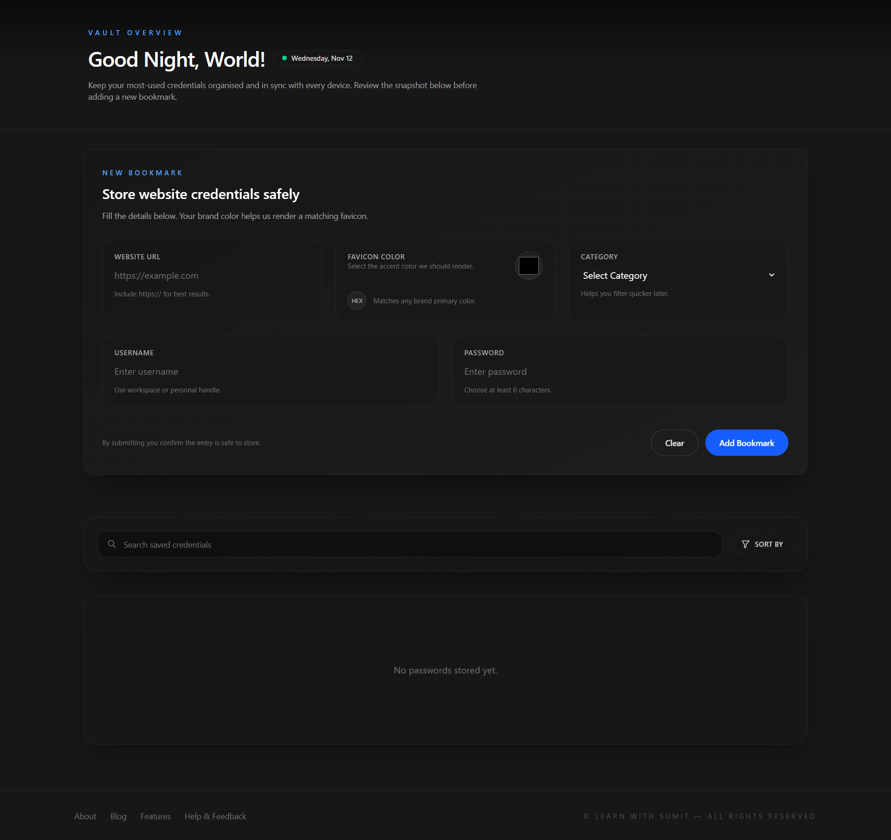
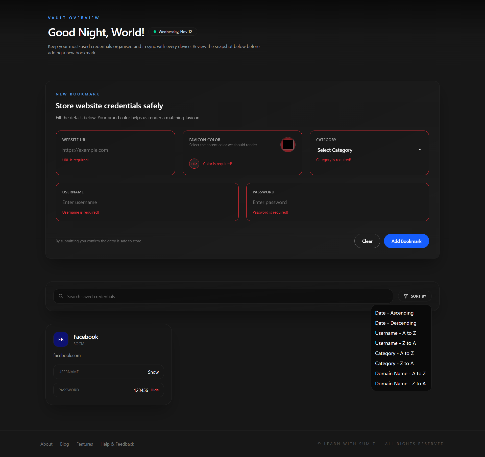
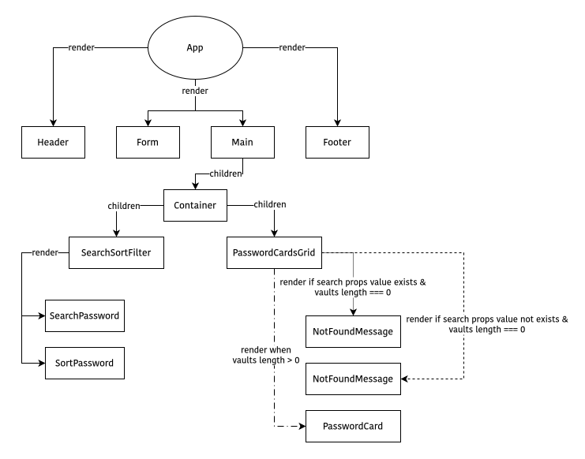
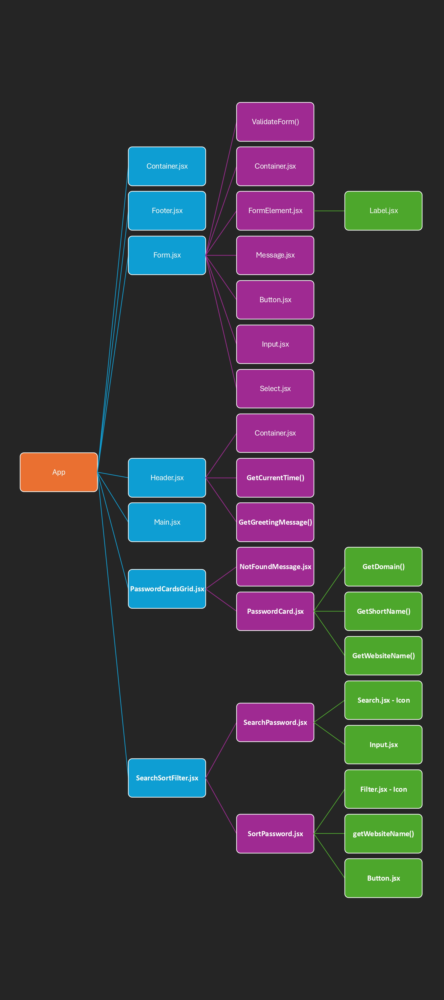

# Vault Manager

A modern, sleek password management application built with React and Tailwind CSS. Store and manage your website credentials securely with an intuitive, dark-themed interface.

<div align="center">
  
  
</div>

## 🔗 Links

-   **GitHub Repository**: [https://github.com/tushar-454/vault-manager](https://github.com/tushar-454/vault-manager)
-   **Live**: [https://vault-manager-nu.vercel.app/](https://vault-manager-nu.vercel.app/)

## 🌟 Features

### 🔐 Credential Management

-   **Secure Storage**: Store website URLs, usernames, and passwords
-   **Color-Coded Cards**: Assign custom colors to each credential for easy visual identification
-   **Category Organization**: Organize credentials by categories (Social, Video, Design, Streaming, etc.)
-   **Password Reveal/Hide**: Toggle password visibility with a single click

### 🔍 Search & Filter

-   **Real-time Search**: Search across URLs, usernames, and categories instantly
-   **Advanced Sorting**: Sort credentials by:
    -   Date (Ascending/Descending)
    -   Username (A-Z / Z-A)
    -   Category (A-Z / Z-A)
    -   Domain Name (A-Z / Z-A)

### 🎨 User Experience

-   **Automatic Favicon Generation**: Custom favicon with website initials and brand color
-   **Website Name Extraction**: Automatically extracts and displays website names from URLs
-   **Time-Based Greeting**: Dynamic greeting message based on current time
-   **Responsive Design**: Fully responsive layout for all screen sizes
-   **Dark Theme**: Modern dark UI with glassmorphism effects

### ✅ Form Validation

-   **Real-time Validation**: Instant feedback on form inputs
-   **URL Validation**: Ensures valid website URLs
-   **Password Strength**: Minimum 6 characters required
-   **Required Fields**: All fields validated before submission
-   **Error Messages**: Clear, helpful error messages for invalid inputs

### 📱 Responsive Layout

-   **Mobile-First**: Optimized for mobile devices
-   **Tablet Support**: Adaptive 2-column grid on tablets
-   **Desktop View**: 3-column grid for larger screens

## 🚀 Getting Started

### Prerequisites

-   Node.js (v18 or higher) _to be exactly **v24.11.1**_
-   npm

### Installation

1. Clone the repository:

```bash
git clone https://github.com/tushar-454/vault-manager.git
cd vault-manager
```

2. Install dependencies:

```bash
npm install
```

3. Start the development server:

```bash
npm run dev
```

4. Open your browser and navigate to `http://localhost:5173`

## 🛠️ Built With

-   **React v19.2.0** - UI library
-   **Tailwind CSS v4.1.17** - Utility-first CSS framework
-   **Vite v7.2.2** - Build tool and development server
-   **ESLint v9.39.1** - Code linting and quality

## 📂 Project Structure

```
vault-manager/
├── public/
├── src/
│   ├── assets/          # SVG icons and images
│   │   ├── Filter.jsx
│   │   └── Search.jsx
│   ├── components/      # React components
│   │   ├── ui/          # Reusable UI components
│   │   │   ├── Button.jsx
│   │   │   ├── Input.jsx
│   │   │   ├── Label.jsx
│   │   │   └── Select.jsx
│   │   ├── Container.jsx
│   │   ├── Footer.jsx
│   │   ├── Form.jsx
│   │   ├── FormElement.jsx
│   │   ├── Header.jsx
│   │   ├── Main.jsx
│   │   ├── Message.jsx
│   │   ├── NotFoundMessage.jsx
│   │   ├── PasswordCard.jsx
│   │   ├── PasswordCardsGrid.jsx
│   │   ├── SearchPassword.jsx
│   │   ├── SortPassword.jsx
│   │   └── SearchSortFilter.jsx
│   ├── utils/           # Utility functions
│   │   ├── index.js
│   │   └── validation.js
│   ├── App.jsx          # Main app component
│   ├── main.jsx         # Entry point
│   └── index.css        # Global styles
├── index.html
├── package.json
├── vite.config.js
└── eslint.config.js
```

## 🌲 Components Tree



## 🌲 Module Dependency Tree



## 🎯 Key Components

### `App.jsx`

-   Root state management for:
    -   vaults (all credentials)
    -   mutateVaults (filtered/sorted view)
    -   search (query)
-   Passes state to SearchSortFilter and PasswordCardsGrid.

### `Form.jsx`

-   Credential input form with validation using `validateForm` from `src/utils/validation.js`.
-   Live validation: URL format and password length while typing.

### `SearchPassword.jsx`

-   Search input for filtering by URL, username, or category.
-   Updates `mutateVaults` with filtered results; clears when query is empty.

### `SortPassword.jsx`

-   Sort menu for current list (works on `mutateVaults` if present, else `vaults`).
-   Supported sorts: date, username, category, and domain name (uses `getWebsiteName`).

### `SearchSortFilter.jsx`

-   Combines search and sort controls in a single toolbar section.

### `PasswordCardsGrid.jsx`

-   Renders grid of `PasswordCard` items.
-   Displays contextual messages when no results or no data.

## 🧰 Utility Functions

### In `src/utils/index.js`

-   `getGreetingMessage` — Time-based greeting (Morning/Noon/Evening/Night)
-   `getCurrentTime` — Formatted current date
-   `getWebsiteName` — Extract readable website name from URL
-   `getDomain` — Extract domain from URL
-   `getShortName` — Generate 2-letter abbreviation for favicon

### In `src/utils/validation.js`

-   `validateForm` — Form validation logic used by `Form.jsx`

## 📝 Available Scripts

```bash
npm run dev      # Start development server
npm run build    # Build for production
npm run preview  # Preview production build
npm run lint     # Run ESLint
```

## 🔒 Security Note

This is a **frontend-only** application. Credentials are stored in browser memory and will be lost on page refresh. For production use, implement:

-   Backend API for persistent storage
-   Encryption for stored passwords
-   User authentication
-   Database integration

## 👨‍💻 Author

**Tushar Imran**

-   GitHub: [@tushar-454](https://github.com/tushar-454)

---

Made with ❤️ using React and Tailwind CSS
