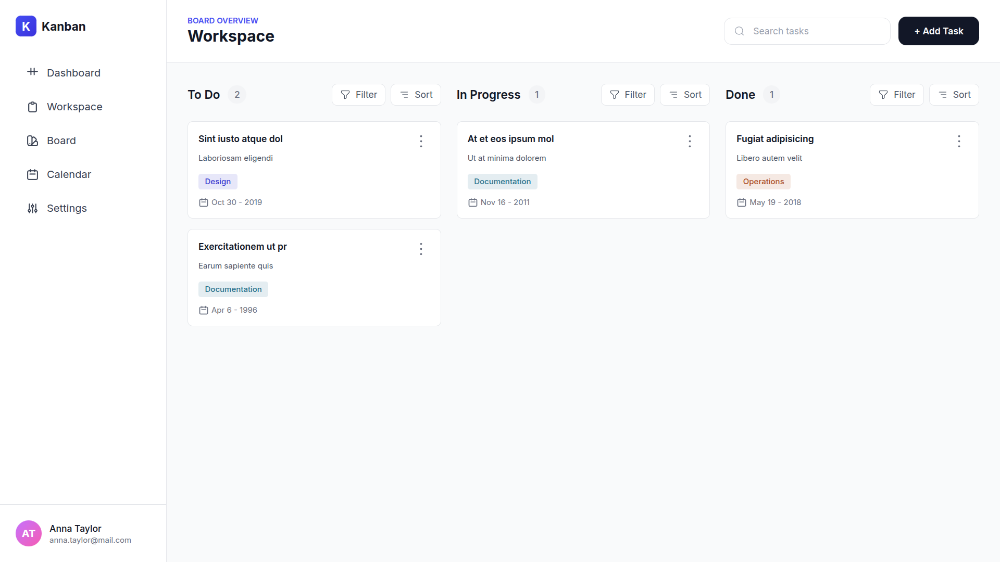
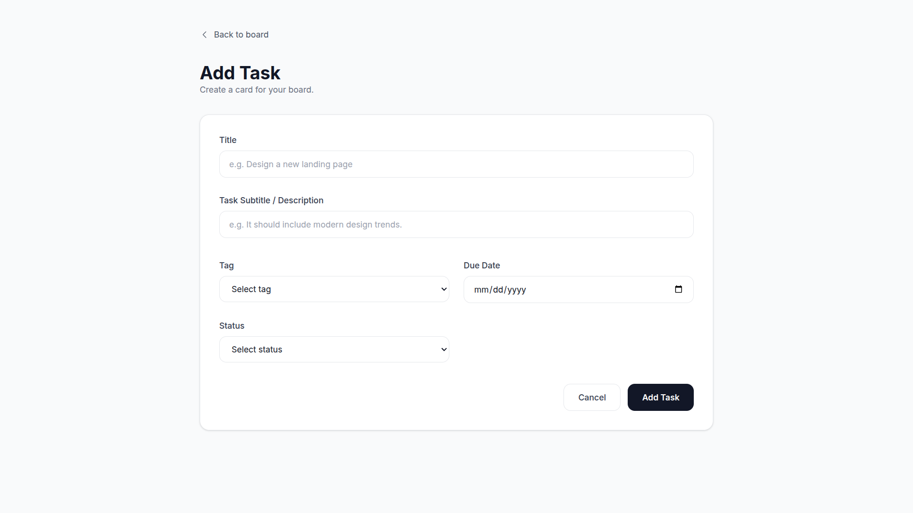
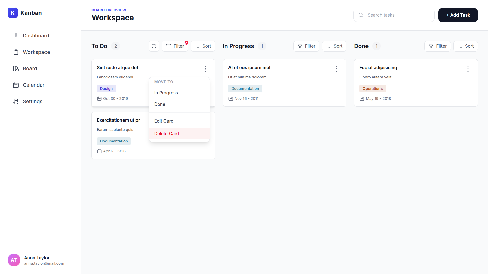
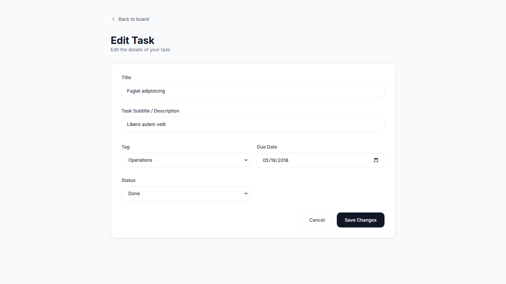
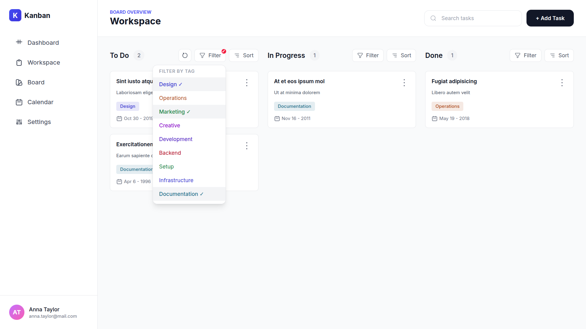
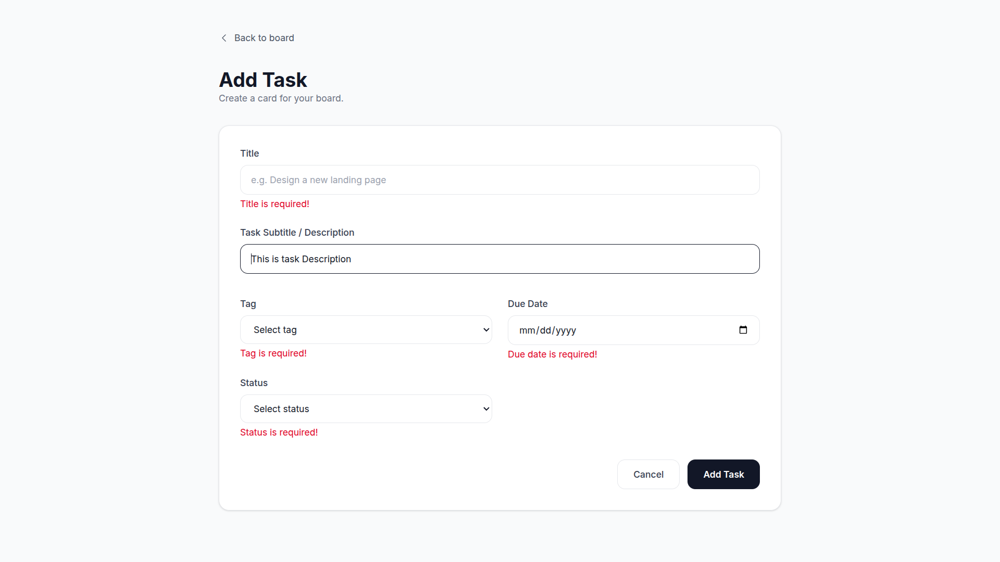
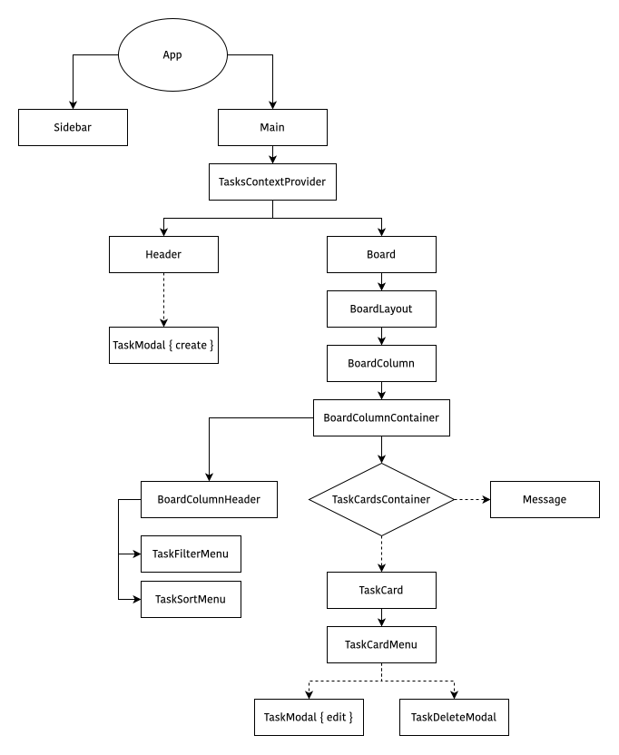

# Kanban Board

A modern, intuitive Kanban board application built with React and TailwindCSS for efficient task management. Organize your workflow across three customizable columns: To Do, In Progress, and Done.

<div align="center">
    
      
</div>
<div align="center">
    
    
</div>
<div align="center">
      
      
</div>

  

## 🔗 Links

-   **Live Demo**: [https://kanban-pi-one.vercel.app](https://kanban-pi-one.vercel.app)
-   **Repository**: [https://github.com/Learn-with-Sumit/batch-4-assignment-3-kanban-board-tushar-454](https://github.com/Learn-with-Sumit/batch-4-assignment-3-kanban-board-tushar-454)
-   **Author**: [tushar-454](https://github.com/tushar-454)

## 🌟 Features

### 📋 Task Management

-   **Create Tasks**: Add new tasks with title, description, tags, due dates, and status
-   **Edit Tasks**: Update task details and move between columns seamlessly
-   **Delete Tasks**: Remove tasks with confirmation modal to prevent accidental deletions
-   **Status Tracking**: Organize tasks across three columns - To Do, In Progress, and Done
-   **Task Tags**: Categorize tasks with 9 predefined color-coded tags (Design, Operations, Marketing, Creative, Development, Backend, Setup, Infrastructure, Documentation)

### 🔍 Search & Filter

-   **Real-time Search**: Instantly search tasks by title or description
-   **Advanced Filtering**: Filter tasks by tags within each column
-   **Multi-tag Support**: Apply multiple tag filters simultaneously
-   **Visual Indicators**: Active filter badges show when filters are applied

### 📊 Sorting & Organization

-   **Date Sorting**: Sort tasks by newest or oldest due date
-   **Column-specific Controls**: Independent sort and filter for each column
-   **Reset Functionality**: Quick reset button to clear all filters and sorts
-   **Task Counter**: Display task count for each column

### 🎨 User Experience

-   **Drag-free Design**: Simple click-based interface for task management
-   **Modal-based Forms**: Clean, focused forms for adding and editing tasks
-   **Hover Effects**: Smooth transitions and visual feedback on interactive elements
-   **Empty States**: Helpful messages when columns have no tasks
-   **Confirmation Dialogs**: Safety checks before destructive actions

### ✅ Form Validation

-   **Real-time Validation**: Instant feedback on required fields
-   **onBlur Validation**: Field-level validation as you navigate the form
-   **Error Messages**: Clear, descriptive error messages for each field
-   **Required Fields**: Title, description, tag, due date, and status validation

### 📱 Responsive Layout

-   **Mobile-first Design**: Optimized for mobile devices
-   **Tablet Support**: Adaptive layout for medium screens
-   **Desktop Optimized**: Full sidebar and multi-column view on large screens
-   **Flexible Grid**: Responsive board columns that stack on smaller screens

### 🎯 Additional Features

-   **Context API**: Centralized state management for tasks
-   **Reducer Pattern**: Predictable state updates with actions (ADD_TASK, EDIT_TASK, DELETE_TASK)
-   **UUID Generation**: Unique IDs for each task using crypto.randomUUID()
-   **Date Formatting**: Human-readable date display (e.g., "Nov 21 - 2025")
-   **Tag Colors**: Dynamic color system with background and text variations

## 🚀 Getting Started

### Prerequisites

Before you begin, ensure you have the following installed:

-   **Node.js** (v18.0.0 or higher) - [Download here](https://nodejs.org/)
-   **npm** (v9.0.0 or higher) or **yarn** (v1.22.0 or higher)

### Installation

1. **Clone the repository**

    ```bash
    git clone https://github.com/Learn-with-Sumit/batch-4-assignment-3-kanban-board-tushar-454
    cd kanban
    ```

2. **Install dependencies**

    ```bash
    npm install
    ```

3. **Start the development server**

    ```bash
    npm run dev
    ```

4. **Open your browser**

    Navigate to `http://localhost:5173` to view the application.

### Build for Production

```bash
npm run build
```

The optimized production build will be in the `dist` folder.

### Preview Production Build

```bash
npm run preview
```

## 🛠️ Built With

-   **[React 19.2.0](https://react.dev/)** - JavaScript library for building user interfaces
-   **[TailwindCSS 4.1.17](https://tailwindcss.com/)** - Utility-first CSS framework
-   **[Vite 7.2.4](https://vitejs.dev/)** - Next-generation frontend build tool
-   **[ESLint](https://eslint.org/)** - JavaScript linting utility

### DevDependencies

-   **@vitejs/plugin-react** - Official Vite plugin for React
-   **@tailwindcss/vite** - TailwindCSS Vite integration
-   **eslint-plugin-react** - React-specific linting rules
-   **eslint-plugin-react-hooks** - Enforces Rules of Hooks

## 📂 Project Structure

```
kanban/
├── public/                 # Static assets
├── src/
│   ├── assets/
│   │   └── icons/         # SVG icon components
│   │       ├── Board.jsx
│   │       ├── Calendar.jsx
│   │       ├── Dashboard.jsx
│   │       ├── Filter.jsx
│   │       ├── LeftArrow.jsx
│   │       ├── Reset.jsx
│   │       ├── Search.jsx
│   │       ├── Settings.jsx
│   │       ├── Sort.jsx
│   │       ├── ThreeDot.jsx
│   │       └── Workspace.jsx
│   │
│   ├── components/        # React components
│   │   ├── ui/           # Reusable UI components
│   │   │   └── Button.jsx
│   │   ├── Board.jsx                    # Main board container
│   │   ├── BoardColumn.jsx              # Individual column logic
│   │   ├── BoardColumnContainer.jsx     # Column wrapper
│   │   ├── BoardColumnHeader.jsx        # Column header with controls
│   │   ├── BoardLayout.jsx              # Board grid layout
│   │   ├── FormInputElement.jsx         # Reusable input field
│   │   ├── FormSelectElement.jsx        # Reusable select field
│   │   ├── Header.jsx                   # Top navigation bar
│   │   ├── Main.jsx                     # Main content wrapper
│   │   ├── Message.jsx                  # Empty state messages
│   │   ├── Sidebar.jsx                  # Left navigation sidebar
│   │   ├── TaskCard.jsx                 # Individual task card
│   │   ├── TaskCardMenu.jsx             # Task action menu
│   │   ├── TaskCardsContainer.jsx       # Cards grid container
│   │   ├── TaskDeleteModal.jsx          # Delete confirmation modal
│   │   ├── TaskFilterMenu.jsx           # Filter dropdown menu
│   │   ├── TaskForm.jsx                 # Add/Edit task form
│   │   ├── TaskModal.jsx                # Full-screen task modal
│   │   └── TaskSortMenu.jsx             # Sort dropdown menu
│   │
│   ├── constants/        # Application constants
│   │   └── BoardColumnItems.js          # Board column definitions
│   │
│   ├── context/          # React Context
│   │   └── TasksContext.jsx             # Tasks context definition
│   │
│   ├── hooks/            # Custom React hooks
│   │   └── useTasksContext.js           # Hook to access tasks context
│   │
│   ├── providers/        # Context providers
│   │   └── TasksContextProvider.jsx     # Tasks state provider
│   │
│   ├── reducers/         # State reducers
│   │   └── tasksReducer.js              # Tasks reducer logic
│   │
│   ├── utils/            # Utility functions
│   │   ├── dateToMonthDay.js            # Date formatter
│   │   ├── formatTagLabel.js            # Tag label formatter
│   │   └── getTagColor.js               # Tag color utilities
│   │
│   ├── App.jsx           # Root component
│   ├── main.jsx          # Application entry point
│   └── index.css         # Global styles
│
├── eslint.config.js      # ESLint configuration
├── index.html            # HTML entry point
├── package.json          # Project dependencies
├── vite.config.js        # Vite configuration
└── README.md             # Project documentation
```

## 🌲 Components Tree



## 🎯 Key Components

### TasksContextProvider

**Purpose**: Centralized state management for all tasks across the application.

-   **State**: Manages tasks object with three columns (to-do, in-progress, done)
-   **Search**: Handles global search query state
-   **Reducer**: Uses `tasksReducer` for state updates
-   **Actions**: ADD_TASK, EDIT_TASK, DELETE_TASK

### Board

**Purpose**: Main board view that displays all three columns with filtered tasks.

-   Filters tasks based on search query
-   Passes filtered tasks to each column
-   Responsive grid layout

### BoardColumn

**Purpose**: Individual column with independent filtering and sorting.

-   **Tag Filtering**: Filter tasks by selected tags
-   **Date Sorting**: Sort by newest or oldest
-   **Local State**: Each column maintains its own filter/sort state
-   **Empty State**: Shows message when no tasks match filters

### TaskForm

**Purpose**: Reusable form for adding and editing tasks.

-   **Validation**: Real-time and onBlur validation
-   **Error Handling**: Field-level error messages
-   **Dual Mode**: Works for both Add and Edit operations
-   **Auto-ID**: Generates unique task IDs using crypto.randomUUID()

### TaskCard

**Purpose**: Visual representation of a task with all its details.

-   **Color-coded Tags**: Dynamic tag colors based on category
-   **Due Date Display**: Formatted date (e.g., "Nov 21")
-   **Action Menu**: Three-dot menu for edit/delete actions
-   **Hover Effects**: Smooth shadow transition

### Header

**Purpose**: Top navigation with search and add task functionality.

-   **Global Search**: Real-time search across all tasks
-   **Quick Add**: One-click task creation

### Sidebar

**Purpose**: Left navigation panel with menu links and user profile.

-   **Navigation**: Dashboard, Workspace, Board, Calendar, Settings
-   **User Profile**: Display name and email
-   **Responsive**: Converts to horizontal bar on mobile

## 🧰 Utility Functions

### `getTagColor(tag)`

**Purpose**: Returns color scheme for task tags.

-   **Input**: Tag value (string)
-   **Output**: Object with text color and background color
-   **Tags**: 9 predefined tags with unique colors
-   **Fallback**: Default gray color for unknown tags

### `dateToMonthDay(dateString)`

**Purpose**: Formats ISO date string to readable format.

-   **Input**: ISO date string (e.g., "2025-11-21")
-   **Output**: Formatted string (e.g., "Nov 21")
-   **Months**: Short month names (Jan, Feb, Mar, etc.)

### `formatTagLabel(tag)`

**Purpose**: Formats tag values to proper title case.

-   **Input**: Tag value (e.g., "backend")
-   **Output**: Formatted label (e.g., "Backend")
-   **Logic**: Capitalizes first letter of each word

### `tasksReducer(tasks, action)`

**Purpose**: Manages task state updates.

-   **ADD_TASK**: Adds new task to appropriate column
-   **EDIT_TASK**: Updates task and moves between columns if status changes
-   **DELETE_TASK**: Removes task from its column
-   **Immutable**: Returns new state object without mutations

## 👨‍💻 Author

**Tushar**

-   GitHub: [@tushar-454](https://github.com/tushar-454)
-   Email: [Contact via Gmail](mailto:imtushar454@gmail.com)

---

<div align="center">
  
### ⭐ Star this repository if you find it helpful!

Made with ❤️ using React & TailwindCSS

</div>
